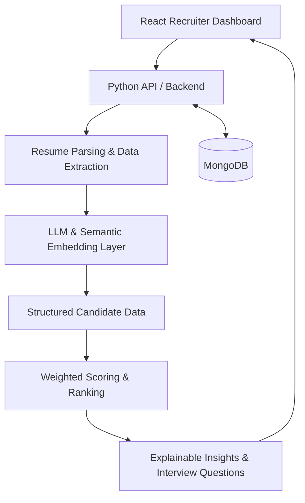

# 🧠 Smart Resume Screening & Interview Preparation Assistant

### AI-Powered Candidate Evaluation | Semantic Matching | Explainable Decision Support

**Kennesaw State University | MSIT Capstone Project | Group P12**

An AI-powered recruitment decision-support prototype designed to streamline resume evaluation, identify candidate-job alignment, and generate tailored interview questions using natural language processing (NLP), semantic embeddings, and generative AI.

**Our approach:** Go beyond keyword matching to support more contextual, transparent, and structured candidate evaluation—while keeping human judgment central to hiring decisions.

---

## 🚀 Project Overview

Recruiters often face challenges evaluating resumes with inconsistent formatting, varied terminology, and complex candidate backgrounds. Traditional keyword-based screening may overlook relevant qualifications expressed differently.

This project explores an intelligent screening solution that combines **semantic AI analysis, structured scoring, and explainable insights** to support early-stage recruitment.

### Key Capabilities

- **Resume Processing:** Ingest PDF/DOCX resumes and extract structured candidate information.
- **Semantic Matching:** Use Sentence Transformer embeddings to assess contextual alignment with job requirements.
- **Candidate Ranking:** Evaluate applicants across skills, experience, education, and projects using configurable scoring weights.
- **Explainable AI:** Generate interpretable insights highlighting qualifications and potential gaps.
- **Interview Preparation:** Generate candidate-specific interview questions using LLMs.
- **Recruiter Dashboard:** Provide a centralized interface for reviewing candidate evaluations.

*Capabilities reflect the documented solution scope; implementation and testing maturity may vary by component.*

---

## 🏗️ System Architecture

The system follows a modular, layered architecture that separates AI processing from deterministic business logic.



### Architecture Highlights

- **Modularity:** Separates frontend, backend, AI services, and data persistence.
- **Explainability:** Combines structured scoring with AI-generated evaluation insights.
- **Flexibility:** Supports configurable scoring and potential model replacement.
- **Scalability:** Designed with asynchronous processing and incremental performance testing in mind.
- **Human Oversight:** Provides decision support without automated candidate rejection.

---

## ⚙️ Technology Stack

| Layer | Technology |
|---|---|
| Frontend | React, JavaScript |
| Backend | Python, API Services |
| Generative AI | LLaMA 3.1 8B (planned primary model) & Gemini 3.8 Flash |
| Semantic Analysis | Sentence Transformers |
| Database | MongoDB |
| Model Deployment Strategy | Hugging Face API |
| Local Model Fallback | LLaMA 3.2 3B (proposed) |
| Collaboration | Git, GitHub |

---

## 📋 Project Lifecycle & Deliverables

This repository documents the capstone lifecycle from initial planning through development, testing, and delivery.

| Phase | Scope |
|---|---|
| **1. Planning & Design** | Requirements analysis, UX wireframes, system architecture, technology selection, and Gantt chart |
| **2. Core Development** | Resume parsing, semantic matching, candidate scoring, interview generation, and application integration |
| **3. Testing & Refinement** | Functional testing, bias assessment, explainability validation, performance evaluation, and UI improvements |
| **4. Final Delivery** | Technical documentation, demonstrations, final reporting, and project submission |

Project milestones, architecture decisions, and supporting documentation are available in the repository.

### Repository Structure

```text
Smart_Resume_Screening/
├── frontend/              # React application
├── backend/               # Python backend services
├── ProjectReportsFiles/   # Reports and project documentation
└── README.md
```

---

## 🛡️ Responsible AI & Design Considerations

The platform is designed as a **human-in-the-loop decision-support system**, not an autonomous hiring solution.

Key principles include:

- Human oversight of candidate evaluation and hiring decisions.
- No automatic candidate rejection.
- Exclusion of protected demographic characteristics from intended scoring inputs.
- Transparent scoring categories and interpretable results.
- Continued evaluation of bias, accuracy, privacy, and reliability.

Semantic similarity does not inherently eliminate bias. Additional validation would be necessary before real-world deployment.

---

## 🔮 Future Enhancements

- Integration with enterprise Applicant Tracking Systems (ATS).
- Advanced fairness auditing and model evaluation.
- Expanded recruiter analytics and scoring customization.
- Optimized batch processing and model inference.
- Enhanced security, privacy, and deployment capabilities.

---

## 🎓 Academic Project & Team Collaboration

**Institution:** Kennesaw State University  
**Program:** Master of Science in Information Technology  
**Project Team:** Group P12

This collaborative capstone demonstrates the application of **AI/ML, systems architecture, business analysis, full-stack development, and technical project delivery** to a real-world business challenge.

### Project Takeaway

> **Effective AI solutions require more than intelligent models. They require thoughtful architecture, reliable integration, transparent business logic, and measurable value.**

---

**Disclaimer:** This project is an academic prototype developed for research and demonstration purposes. It is not a validated production hiring system and does not replace human decision-making.

